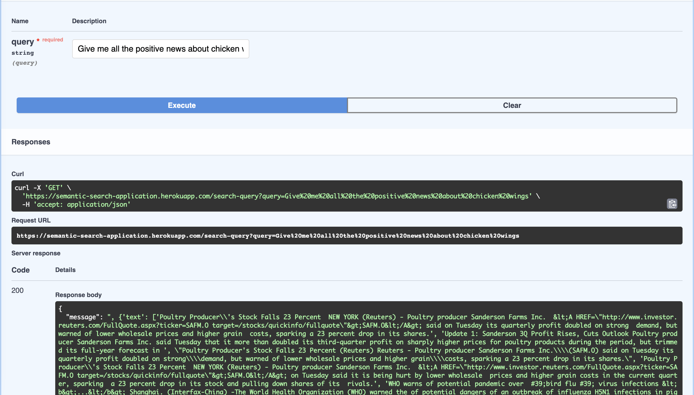

# Semantic Search

> **Continued in [SSV2](https://github.com/therealadarsh/SSV2)**, a rewrite with a
> generic ingestion pipeline, an evaluation harness, a current embedding model and a RAG
> roadmap. This repo stays as the reference for the original project and its CI/CD setup.

[](https://github.com/therealadarsh/Semantic-Search/actions/workflows/ci.yml)

**Semantic search** finds results by meaning, not just matching keywords. Given a query, this
service returns the most similar news articles from the
[AG News](https://huggingface.co/datasets/ag_news) corpus (World, Sports, Business, Sci/Tech).

**How it works**

1. Each article is embedded with a sentence-transformer model
   ([multi-qa-MiniLM-L6-cos-v1](https://huggingface.co/sentence-transformers/multi-qa-MiniLM-L6-cos-v1),
   fine-tuned on synthetic queries; see `scripts/fine_training.py`).
2. The embeddings go into a [FAISS](https://github.com/facebookresearch/faiss) index for fast nearest-neighbour lookup.
3. A query is embedded with the same model, and the closest articles are returned.

> New to the CI/CD side? **[docs/CICD_GUIDE.md](docs/CICD_GUIDE.md)** walks through how this
> repo is built, tested and deployed, and why each piece is there.

## Project layout

```
├── .github/
│   ├── workflows/ci.yml        # lint → test → docker build + smoke test (every PR)
│   ├── workflows/release.yml   # on tag v*: CI → push image to GHCR → deploy
│   └── dependabot.yml          # weekly dependency update PRs
├── data/ag_news_train_12k/     # the 12,000 articles that get indexed
├── models/semantic-model/      # fine-tuned embedding model
├── scripts/
│   ├── settings.py             # paths and model name, shared by every script
│   ├── app.py                  # FastAPI service
│   ├── search_query.py         # SearchEngine (also a CLI)
│   ├── embed_data.py           # builds data/training_index.faiss
│   ├── fetch_load_data.py      # re-downloads the dataset
│   └── fine_training.py        # fine-tunes the model (offline, GPU)
├── tests/                      # unit, integration and Docker smoke tests
├── Dockerfile                  # multi-stage: deps → index → runtime
└── Makefile                    # the same commands CI runs
```

## Running locally

Requires Python 3.12+.

```bash
make install                      # .venv with CPU-only PyTorch + dev tools + pre-commit hook
source .venv/bin/activate
make index                        # build the FAISS index (about a minute on CPU)
make run                          # http://localhost:8000/docs
```

```bash
python scripts/search_query.py "olympic gold medal"     # search from the command line
curl "http://localhost:8000/search-query?query=olympic%20gold%20medal&k=3"
```

## Checks

```bash
make lint     # ruff
make test     # pytest (unit + integration)
make smoke    # build the Docker image, start it, and run a real search against it
```

## Docker

```bash
make docker-build
make docker-run                   # http://localhost:8000/docs
```

## API

| Endpoint | Description |
| --- | --- |
| `GET /health` | Liveness check, returns `{"status": "ok"}` |
| `GET /search-query?query=...&k=5` | Top `k` (1 to 50) articles with category and distance (lower is closer) |
| `GET /docs` | Interactive OpenAPI docs |

## Releasing

```bash
git tag v1.0.0 && git push origin v1.0.0
```

This runs CI, publishes `ghcr.io/therealadarsh/semantic-search:1.0.0` (and `latest`), and,
once deployment is configured, deploys it. See
[the guide](docs/CICD_GUIDE.md#4-one-time-github-settings) for the one-time setup.


